# 💡 Ideate

> **The Collaborative Idea Incubation Board with an Embedded AI Teammate**

[](https://react.dev/)
[](https://vitejs.dev/)
[](https://tailwindcss.com/)
[](https://supabase.com/)
[](https://ideate-black.vercel.app/)
[](https://developer.nvidia.com/nim)

**Ideate** is a real-time collaboration workspace where teams turn early ideas into structured, execution-ready ventures. Each idea gets its own collaborative space for discussion, files, voice notes, decisions, and an embedded AI teammate: **Idvy**.

- **Live application:** [ideate-black.vercel.app](https://ideate-black.vercel.app/)
- **Repository:** [github.com/Rahul6158/Ideate](https://github.com/Rahul6158/Ideate)

---

## 📸 Product Screenshots

The screenshots below show the main workflows and features in Ideate. All images are stored in the repository's [`ideate-screenshots/`](./ideate-screenshots/) directory.

### Idea spaces and collaboration

| Collaborative idea space | Create a new idea |
|---|---|
| 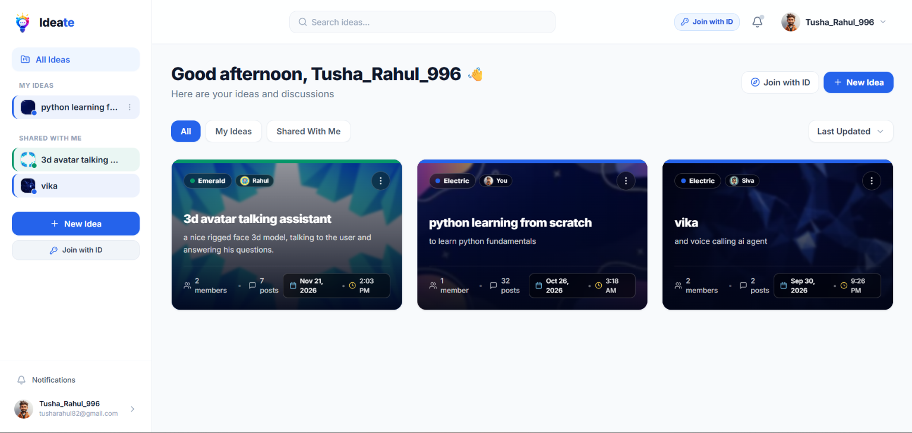 | 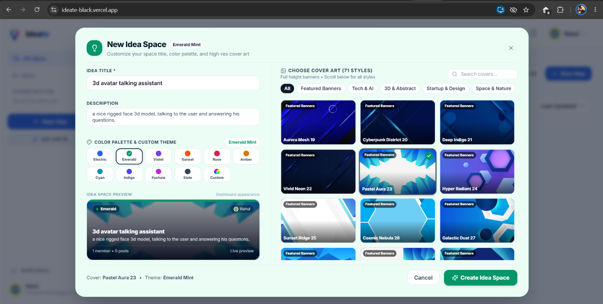 |

| Add collaborators | Collaborator discussion with Idvy |
|---|---|
| 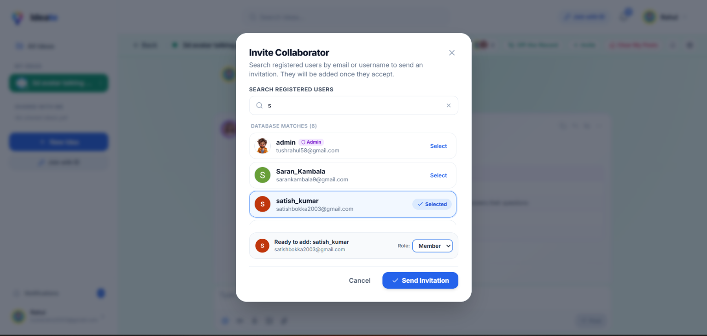 | 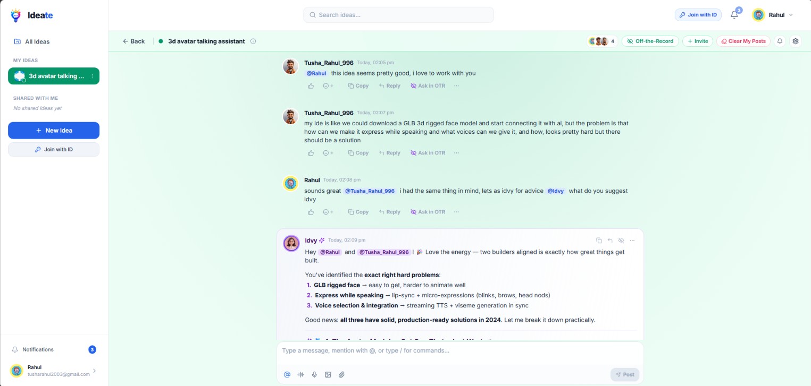 |

| In-idea chat |
|---|
| 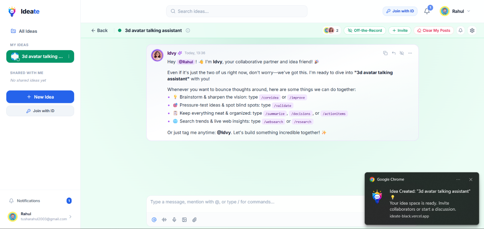 |

### Idvy AI assistant

| AI assistant | AI answers about an idea |
|---|---|
| 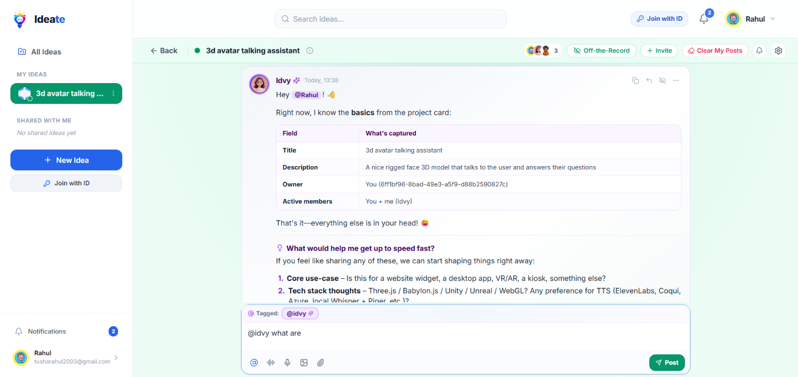 | 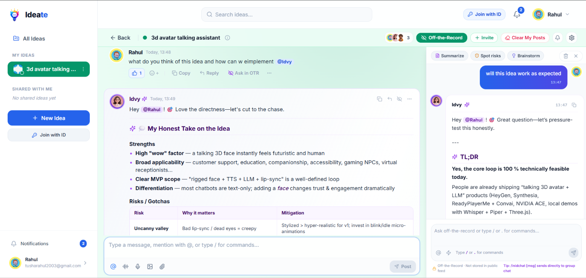 |

| Slash commands |
|---|
|  |

### Permissions, profiles, and notifications

| Member AI permissions | Idea owner AI access controls |
|---|---|
| 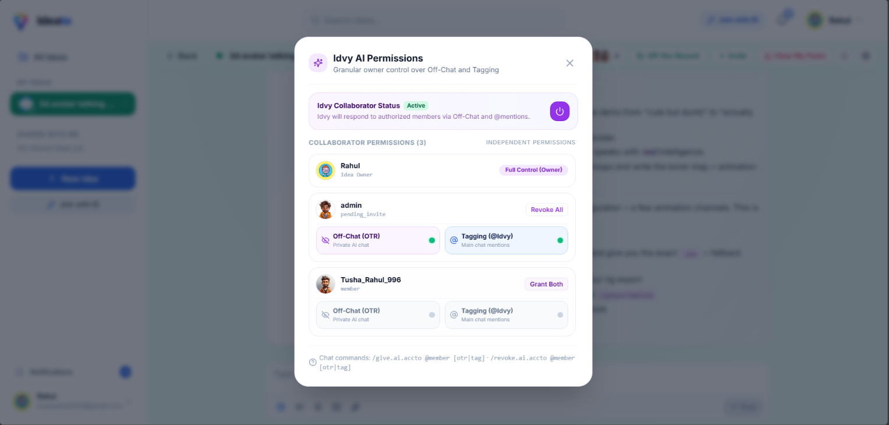 | 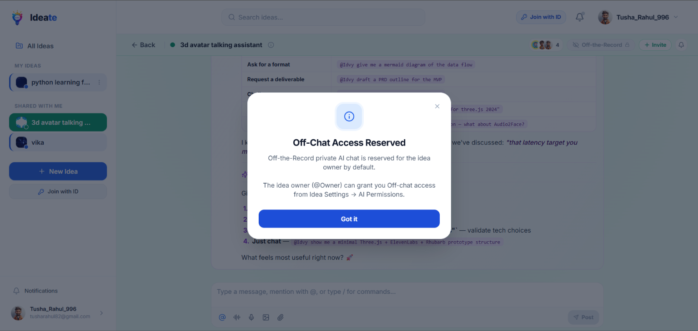 |

| Profile and avatar options | Live notifications |
|---|---|
| 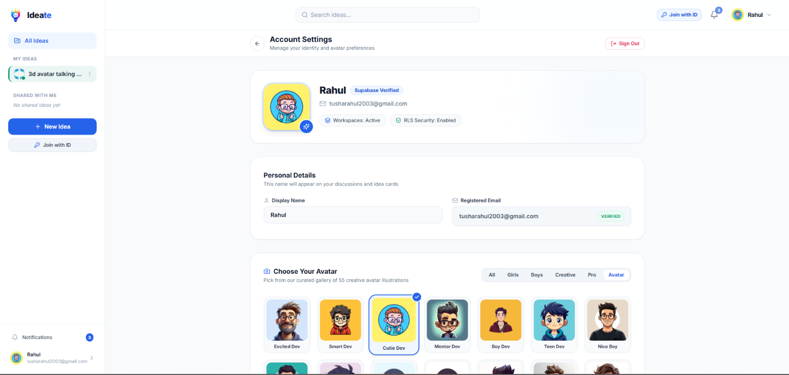 | 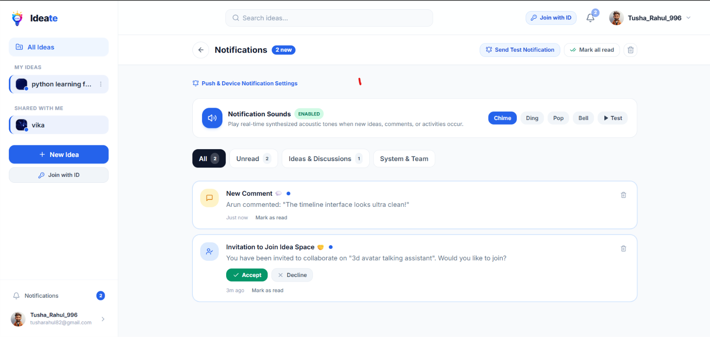 |

| Slash command reference |
|---|
|  |

---

## 🌟 What is Ideate?

Traditional project tools such as Jira, Trello, and Notion are useful for tracking already-defined tasks, while chat apps such as Slack and Discord can bury important decisions in busy channels.

**Ideate bridges this gap.** Every idea has a dedicated, living workspace where team members can discuss proposals, share audio notes, upload references, track decisions, and work with **Idvy**—an AI partner embedded directly in the collaboration flow.

---

## 🚀 How It Works

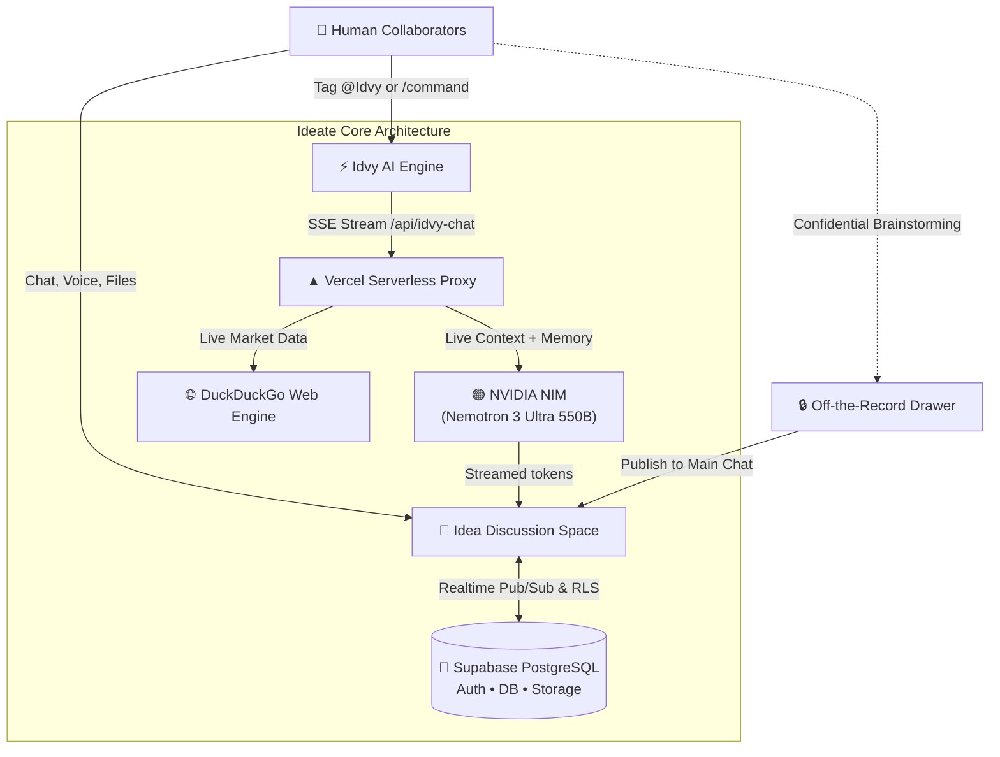

1. **Create an Idea Space:** Add a title, description, category, and theme palette.
2. **Invite Teammates:** Share join links or add members with custom collaborator roles.
3. **Collaborate in Real Time:** Use chat, live typing indicators, reactions, and voice notes.
4. **Invoke Idvy:** Mention `@Idvy` or use a slash command to brainstorm, ask questions, and summarize.
5. **Receive Streamed Answers:** Idvy streams responses using Server-Sent Events (SSE).
6. **Track Decisions:** Distinguish confirmed team consensus from open suggestions and retain useful context.

---

## ✨ Core Features

### 1. 🤖 Idvy — The Resident AI Collaborator

Idvy works inside the team's discussion rather than in a separate chatbot window.

- **Context-aware responses:** Uses recent messages, idea objectives, member roles, and prior decisions to inform responses.
- **Rolling memory (`idea_ai_memory`):** Retains key decisions, milestones, and unresolved questions across sessions.
- **In-context assistance:** Helps with brainstorming, summaries, validation, risks, and action items.

### 2. ⚡ Real-Time Streaming

- **Server-Sent Events (SSE):** Responses are streamed through `/api/idvy-chat` using `text/event-stream`.
- **Faster feedback:** The project is designed to reduce the wait before users see the first generated response.
- **Typing indicator:** An animated cursor indicates when Idvy is generating a response.

### 3. 🔒 Off-the-Record (OTR) Private Consulting

- A private side drawer for exploring sensitive topics, testing ideas, or drafting proposals with Idvy.
- **Post to Main Chat:** Publish a prepared proposal into the shared idea discussion when it is ready.

### 4. 🌐 Live Web Research & Market Intelligence

- Web search and research commands powered by DuckDuckGo.
- Idvy can synthesize industry information, competitor landscapes, and trends, with clickable source attribution where available.

### 5. 🛡️ AI Governance & Permissions

- **Global platform pause:** Admins can pause AI activity across the platform.
- **Idea-level controls:** Idea owners can enable or disable Idvy for an individual idea.
- **Member privileges:** Control who can tag Idvy in public discussions and who can access private OTR sessions.
- **User restrictions:** Admins can restrict individual users from accessing AI inference.

### 6. 🎨 Personalization & Rich Media

- **Illustrated avatars:** 41+ profile avatar options across different categories.
- **Theme palettes:** Customize the visual theme of each idea board.
- **Voice notes:** Record and play audio notes in the app.
- **Attachments:** Upload files and images using Supabase Storage.
- **Web push notifications:** Receive browser notifications for messages, replies, and mentions.

---

## ⌨️ Idvy Slash Commands

Type `/` or mention `@Idvy` in an idea discussion or private drawer.

| Command | Syntax | Description |
|---|---|---|
| **Summarize** | `/summarize` | Summarizes recent progress, key takeaways, and next steps. |
| **Summarize a member** | `/summarize @username` | Highlights a specific teammate's contributions and suggestions. |
| **Core idea** | `/coreidea` | Distills the value proposition, target user, and differentiator. |
| **Validate** | `/validate [proposal]` | Reviews strengths, assumptions, challenges, and next steps. |
| **Decisions** | `/decisions` | Separates confirmed team consensus from open suggestions. |
| **Action items** | `/actionitems` | Generates next steps and assigns owners where possible. |
| **Open questions** | `/openquestions` | Identifies unresolved questions, risks, and decisions. |
| **Improve** | `/improve [optional angle]` | Suggests creative ways to strengthen the concept. |
| **Risks** | `/risks` | Identifies market, technical, and adoption risks with mitigations. |
| **Web search** | `/websearch [query]` | Searches the web and summarizes findings with citations. |
| **Research** | `/research [topic]` | Produces a deeper competitor and market research report. |
| **Private** | `/private` | Opens the confidential Off-the-Record drawer. |
| **Help** | `/help` | Displays the command reference and usage tips. |

---

## 🏗️ Tech Stack

### Frontend

- **Framework:** [React 18](https://react.dev/) and [Vite 6](https://vitejs.dev/)
- **Styling:** [Tailwind CSS 3.4](https://tailwindcss.com/) with glassmorphism design tokens
- **Icons:** [Lucide React](https://lucide.dev/)
- **Audio and media:** Web Audio API and HTML5 Audio

### Backend & API

- **Serverless API:** Vercel Serverless Functions (`/api/idvy-chat.js`)
- **Fallback:** Supabase Edge Functions (Deno runtime)
- **AI inference:** [NVIDIA NIM](https://developer.nvidia.com/nim), configured for `nvidia/nemotron-3-ultra-550b-a55b`
- **Web search:** DuckDuckGo HTML parser

### Database & Authentication

- **Database:** PostgreSQL on [Supabase](https://supabase.com/) with Row Level Security (RLS)
- **Realtime:** Supabase Realtime channels
- **Authentication:** Supabase Auth (email/password and Google OAuth 2.0)
- **File storage:** Supabase Storage buckets, including `post-attachments` and `avatars`

---

## ⚙️ Environment Variables

Create a `.env` file in the project root. Add your own credentials; do not commit real secrets.

```ini
# Supabase
VITE_SUPABASE_URL=https://<your-project-id>.supabase.co
VITE_SUPABASE_ANON_KEY=<your-supabase-anon-key>

# NVIDIA NIM
NVIDIA_API_KEY=<your-nvidia-api-key>
NVIDIA_MODEL=nvidia/nemotron-3-ultra-550b-a55b
NVIDIA_BASE_URL=https://integrate.api.nvidia.com/v1

# Web Push Notifications (optional)
VITE_VAPID_PUBLIC_KEY=<your-vapid-public-key>
VAPID_PRIVATE_KEY=<your-vapid-private-key>
VAPID_SUBJECT=mailto:admin@ideate.app
```

> Keep private keys and server-side secrets out of client-side variables and source control. Only variables intentionally exposed to the browser should use the `VITE_` prefix.

---

## 💻 Local Development

### Prerequisites

- [Node.js](https://nodejs.org/) 18 or later
- npm 9 or later
- A Supabase project with the required database migrations applied
- An NVIDIA NIM API key ([NVIDIA Build](https://build.nvidia.com/))

### Installation

```bash
# Clone the repository
git clone https://github.com/Rahul6158/Ideate.git
cd Ideate

# Install dependencies
npm install
```

### Run the development server

```bash
npm run dev
```

Open [http://localhost:5173](http://localhost:5173) in your browser.

### Create a production build

```bash
npm run build
npm run preview
```

---

## 🔒 Security & Data Privacy

- **Row Level Security:** Access to ideas, members, and posts is enforced at the PostgreSQL level using Supabase authentication.
- **Protected AI credentials:** Keep NVIDIA and other server-side API keys on the server. The browser should communicate with the AI proxy rather than receive private provider credentials.
- **Off-the-Record sessions:** The private drawer is intended for confidential brainstorming. Review the implementation and deployment configuration to understand exactly where OTR data is stored and processed before using it for sensitive information.

---

## 📄 License

This project is licensed under the MIT License.

---

<p align="center">
  Built for collaborative thinking with <strong>Ideate</strong> and <strong>Idvy</strong>.
</p>
